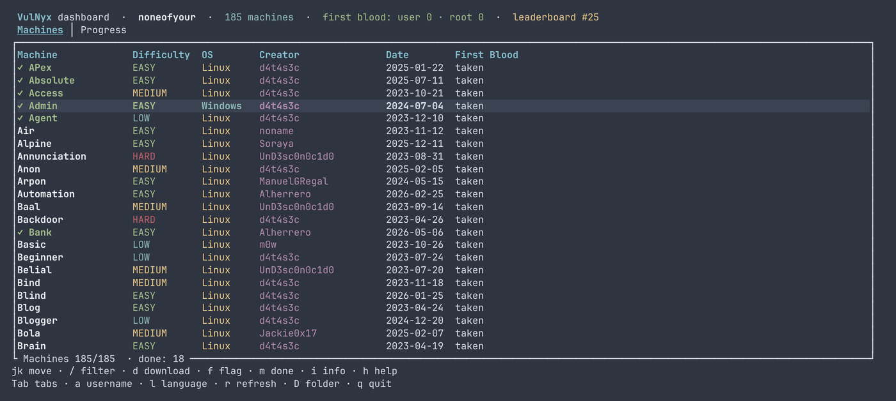
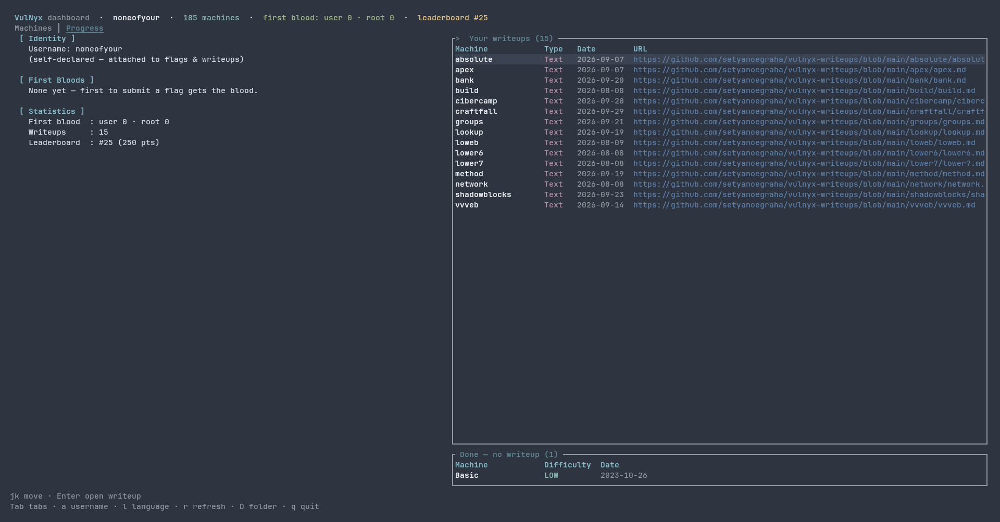
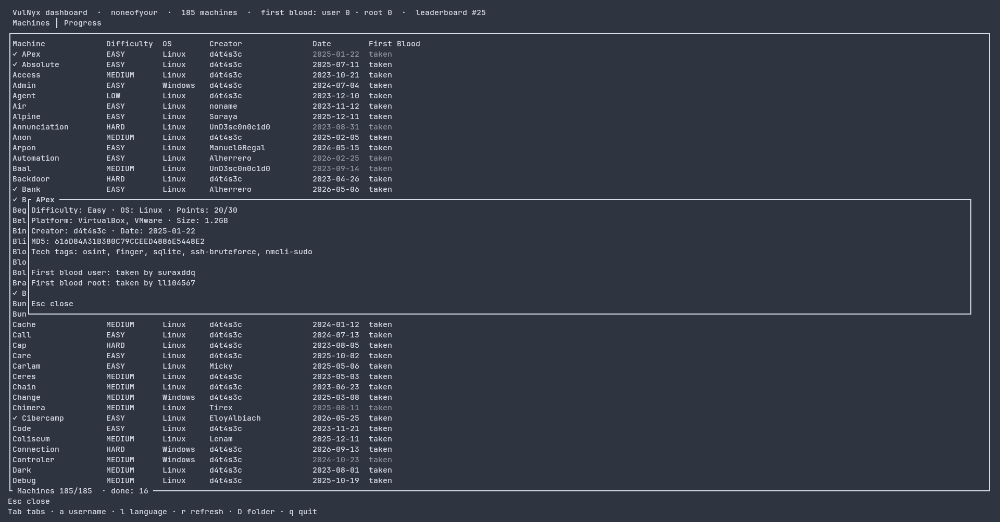
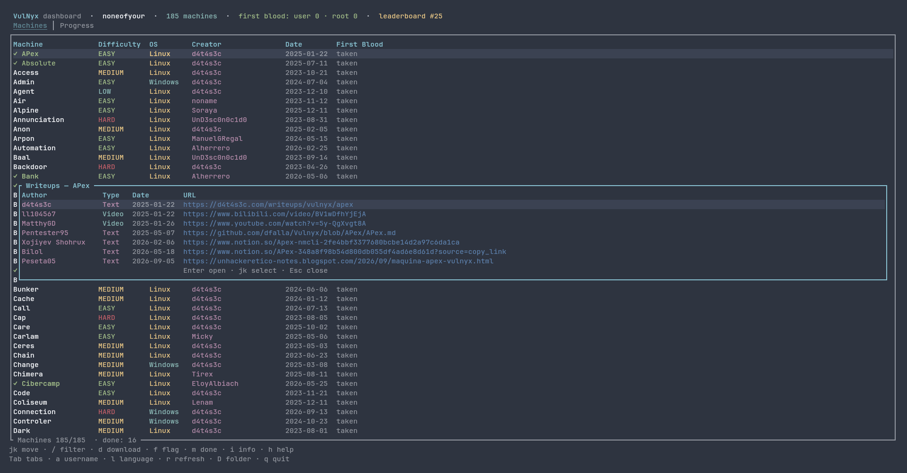
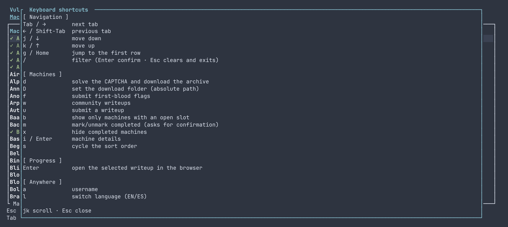
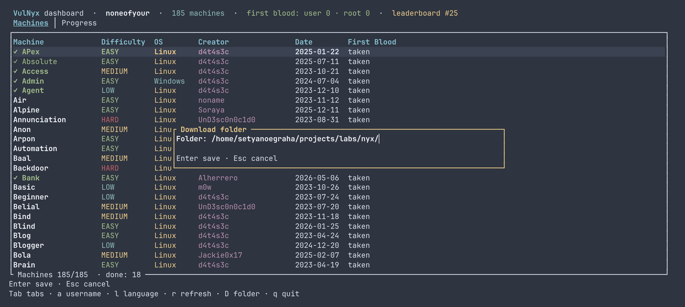
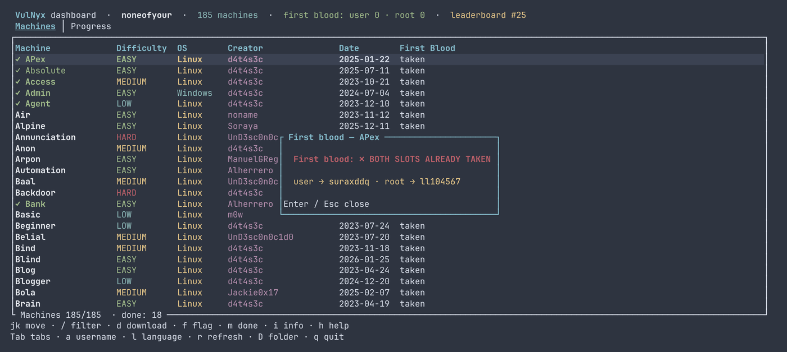

# nyx-tui

### Unofficial VulNyx terminal dashboard

<p align="center">
  
</p>

**[English](README.md) | [Español](README.es.md)**

---

**nyx-tui** is an interactive terminal dashboard for [VulNyx](https://vulnyx.com): browse the machine catalog, submit first-blood flags, read and submit community writeups, and track your leaderboard position — all without leaving the terminal.

Downloads run end-to-end in the terminal. Press `d` and nyx fetches the download page, reads the CAPTCHA image itself, submits the code, resolves the Proton Drive link and streams the archive into your download folder with a live progress line. No browser round trip, no manual code entry.

One command, one screen: running `nyx` opens the dashboard. Written in pure **Rust** (ratatui), shipped as a single static binary. Nord theme. The whole interface is **English or Spanish**, switchable with `l`. **No account needed** — just a username.

---

## Screenshots

| Machines | Progress |
| :---: | :---: |
|  |  |
| **Machine details** | **Community writeups** |
|  |  |
| **Keyboard shortcuts** | **Download folder** |
|  |  |
| **First blood** | |
|  | |

## Features

* **One command** — `nyx` opens the dashboard: catalog, first-blood flags, writeups and your leaderboard position in one screen.
* **Machines** — the full catalog with the site's official difficulty colors (Low/Easy/Medium/Hard), OS (Linux/Windows), tech tags, and first-blood status per machine. Instant `/` filtering and `s` sorting (site order → name → date → difficulty).
* **In-app downloads** — `d` solves the CAPTCHA and streams the machine archive from Proton Drive to your download folder, with speed and size in the footer. One attempt per press; the platform limit is reported, never retried. **At most two transfers run at once** — a third `d` shows a warning popup, and each running transfer gets its own progress line in the footer. Quitting while transfers run asks for confirmation and cancels them only if you confirm.
* **First-blood flag submission** — `f` opens a popup to submit User and Root flags (MD5). Slots already taken are shown as read-only notices; open slots are ready for your MD5 hash. Your username is attached automatically.
* **First-blood filter** — `b` shows only machines with an open first-blood slot, so you can be the first to pwn a fresh release.
* **Writeups** — per-machine community writeups popup (`w`): articles 📝 and videos 🎥 with author, language and date. Submit your own (`u`) — the submission popup uses pickers for **type** (Text/Video, single-select) and **language** (all 62 codes of vulnyx.com, multi-select), so nothing gets mistyped.
* **Completed tracking** — machines you finished turn `✓` green in the list: automatic when one of your writeups is approved on the site, or manually per machine with `m` (confirmation required, persisted locally). `x` hides completed machines so only pending ones remain.
* **Progress** — your first bloods, writeups and leaderboard position (computed from public data with the site's own scoring rules, including the site's staff exclusions so ranks match vulnyx.com). Below *Your writeups*, a **Done — no writeup** table lists machines you marked completed that have no writeup yet; both tables scroll with the same `j`/`k` cursor and mark the focused one with `▸`.
* **Username management** — `a` opens the username popup; whatever you set is attached to all submissions and used for your leaderboard position.
* **UI language** — `l` toggles the whole interface between **English** and **Español** instantly (status messages, popups, hints, everything). Your choice is saved and restored on every launch.
* **Shortcut reference** — `h` opens a scrollable panel listing every key, grouped by context.

---

## Prerequisites

* **OS**: Linux (developed and tested on Arch Linux); macOS and Windows binaries are published for both x86_64 and arm64.
* A [VulNyx](https://vulnyx.com) account is **not** required — the platform works with a self-declared username.

---

## Installation

### 1. From a release binary (easiest)

Grab the archive for your platform from the [Releases](https://github.com/setyanoegraha/nyx-tui/releases) page:

| Platform | Archive |
| :--- | :--- |
| Linux x86_64 | `nyx-v0.3.1-x86_64-unknown-linux-gnu.tar.gz` |
| Linux arm64 | `nyx-v0.3.1-aarch64-unknown-linux-gnu.tar.gz` |
| macOS Apple Silicon | `nyx-v0.3.1-aarch64-apple-darwin.tar.gz` |
| macOS Intel | `nyx-v0.3.1-x86_64-apple-darwin.tar.gz` |
| Windows x86_64 | `nyx-v0.3.1-x86_64-pc-windows-msvc.zip` |
| Windows arm64 | `nyx-v0.3.1-aarch64-pc-windows-msvc.zip` |

```bash
tar xzf nyx-v0.3.1-x86_64-unknown-linux-gnu.tar.gz
install -m 755 nyx ~/.local/bin/nyx
```

### 2. From source

```bash
git clone https://github.com/setyanoegraha/nyx-tui.git
cd nyx-tui
cargo install --path .
```

### 3. From git directly

```bash
cargo install --git https://github.com/setyanoegraha/nyx-tui.git
```

> Requires the Rust toolchain (1.96+): https://rustup.rs

---

## First Setup

Just run:

```bash
nyx
```

The dashboard loads immediately — no login popup. Press `a` to set your **username** (e.g. `noneofyour`). This username is attached to all flag and writeup submissions and used to compute your leaderboard position. You can change it at any time.

### Command line

```
nyx            open the interactive dashboard
nyx --version  print the version
nyx --help     show the short usage text
```

Everything else lives inside the dashboard.

---

## Usage Guide

Two keyboard-driven tabs — **Machines** and **Progress**:

| Keys | Action |
| :--- | :--- |
| `Tab` / `←` `→` | Switch tabs |
| `↑` `↓` / `j` `k` | Move selection |
| `g` / `Home` | Jump to the top of the list |
| `/` | Filter the current list (type to narrow, `Enter` keeps it, `Esc` clears & exits) |
| `s` | **Machines** — cycle sort: site order → name → date → difficulty |
| `b` | **Machines** — show only machines with an open first-blood slot |
| `m` | **Machines** — mark/unmark the selected machine as completed (stored locally); asks for confirmation, with different wording when the machine carries the mark already |
| `D` | **Anywhere** — download folder popup; the path must be absolute (`~` is expanded) |
| `h` | **Anywhere** — full keyboard-shortcut panel, scrollable with `j`/`k` |
| `x` | **Machines** — hide/show completed machines |
| `d` | **Machines** — solve the download CAPTCHA and download the archive from Proton Drive |
| `f` | **Machines** — first-blood flag popup: submit User and/or Root flags (MD5). Slots already taken are shown as read-only notices |
| `w` | **Machines** — community writeups popup for the selected machine: `j`/`k` select, `Enter` opens the link |
| `u` | **Machines** — submit a writeup URL for the selected machine (pending admin review) |
| `i` / `Enter` | **Machines** — description popup with tags, platforms, MD5, first-blood holders |
| `a` | **Anywhere** — username popup |
| `l` | **Anywhere** — toggle UI language EN/ES (persisted) |
| `Enter` | **Progress** — open the selected writeup in your browser (writeup rows only) |
| `r` | Re-fetch all data |
| `q` / `Esc` / `Ctrl-C` | Quit |

### Downloads

VulnyX gates machine downloads behind a 5-character CAPTCHA image. nyx-tui reads the image itself:

1. Press `d` on a machine — nyx fetches the download page and the CAPTCHA in one session, decodes the
   image against the site's fixed 30-character alphabet (`A-Z` without `I`, `O`, `S`; digits without
   `0`, `1`, `5`), and submits the code.
2. On success it resolves the Proton Drive link itself and downloads the archive to your download
   directory, streaming progress into the footer (`↓ APex · APex.zip · 188.0 MB/1.2 GB · 3.6 MB/s`).
   The directory defaults to `~/Downloads/nyx`; change it with `D` (absolute paths only) or by editing
   `"download_dir"` in `~/.nyx-tui/config.json`. An archive already on disk with the right size is not fetched again.
3. If the image cannot be read (the site changed its font), or Proton refuses the transfer, nyx opens
   the link in your browser instead so you can continue by hand.

nyx allows **at most two simultaneous transfers**; a third `d` is refused with a warning popup until one finishes. The platform itself allows **2 VM downloads per minute**; nyx makes exactly one attempt per `d` press and
reports the limit instead of retrying. Partial transfers use a `.part` file and are discarded when the
download fails or you quit, so there is no resume. Quitting with transfers running opens a confirmation popup: `Enter` cancels every transfer and exits, `Esc` keeps them running.

### Where Your Data Lives

- `~/.nyx-tui/config.json` — your **username**, UI language, download folder and locally marked completed machines. Nothing else.
- No password is stored — VulNyx has no accounts, and the username is self-declared.

---

## Updating

```bash
cargo install --git https://github.com/setyanoegraha/nyx-tui.git --force
```

or grab the latest release binary from the [Releases](https://github.com/setyanoegraha/nyx-tui/releases) page.

### Uninstallation & Cleanup

```bash
cargo uninstall nyx
```

Delete `~/.nyx-tui/` to clear all local data.

---

## Disclaimer

nyx-tui is an **unofficial** community tool and is not affiliated to VulNyx. It only uses the platform's public JSON data and completes the same CAPTCHA gate the web app uses, one download at a time — be kind to the service.

---

## Acknowledgements

Thanks to the VulNyx team and community for the platform, and to the [ratatui](https://github.com/ratatui/ratatui) team for the toolkit.

Sibling projects:
- [hmv-tui](https://github.com/setyanoegraha/hmv-tui) — the same dashboard concept for HackMyVM
- [dl-tui](https://github.com/setyanoegraha/dl-tui) — the same dashboard concept for DockerLabs

---

Made with ❤️ by [Ouba](https://github.com/setyanoegraha).

*Happy hacking on VulNyx!*
